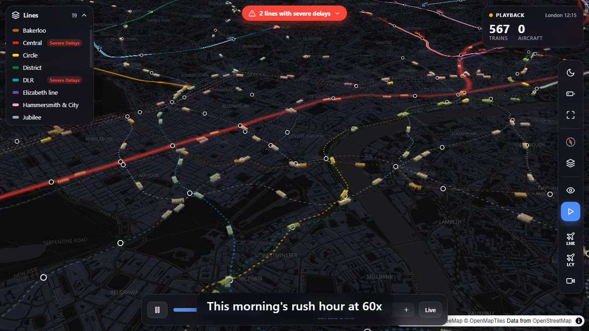
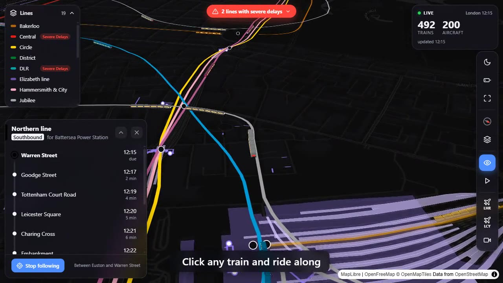

# Live City 3D

**Every train in London, live, in 3D.** About 500 Tube, Elizabeth line, Overground and DLR trains moving
along the real track, under the streets and over the viaducts, plus every aircraft overhead.



▶ **[Watch the 1-minute demo](docs/demo/demo.mp4)** · 📖 **[How it works](docs/HOW-IT-WORKS.md)**

TfL doesn't publish where its trains are. It publishes countdowns: "train 241 reaches Warren Street in 95 seconds".
This app works backwards from those countdowns to a point on the real track, then animates every train between
updates. The [write-up](docs/HOW-IT-WORKS.md) walks through the maths.

## Features

- **Live trains in 3D** on real OpenStreetMap track. Six-carriage models bend round curves and share corridors in lanes.
- **Underground, surface and elevated**: tunnels are drawn below ground, viaducts above it.
- **Click a train** for its next stops and a photo of the train type. **Follow** it and the camera rides along.
- **Click a station** for a live departures board, facilities and a photo.
- **Live aircraft** over London from ADS-B, with Heathrow and City airport shortcuts.
- **Playback**: scrub back through the last 24 hours at up to 600x.
- **Delay alerts** from TfL service status, highlighted on the map.
- **Day and night** by London's real sunset, an Underground Mode with station layouts, and a phone layout.



## Quick start

You need [Node.js](https://nodejs.org) 22 or newer.

```bash
git clone https://github.com/GOURAVPY/3d-UK-.git
cd 3d-UK-
npm run setup
cp backend/.env.example backend/.env
npm run dev
```

Then open http://localhost:5173.

Put a free TfL key in `backend/.env` ([get one here](https://api-portal.tfl.gov.uk)). Without a key it still runs, but
TfL rate-limits you and some lines go missing.

## Scripts

Run these from the repo root.

| Command                | What it does                                                  |
| ---------------------- | ------------------------------------------------------------- |
| `npm run setup`        | Install everything (root, backend, frontend)                  |
| `npm run dev`          | Start the API on :3001 and the web app on :5173, with reload  |
| `npm run build`        | Production build of the frontend into `frontend/dist`         |
| `npm run typecheck`    | Type-check backend and frontend                               |
| `npm run format`       | Format the code with Prettier                                 |

The track data in `backend/data` is already built. To rebuild it from OpenStreetMap, run
`npm run data:download` and then `npm run data:build` inside `backend`.

## How it's built

```
TfL API ──every 30 s──▶ backend ──WebSocket──▶ browser
adsb.lol ──every 10 s─▶ (Node, Express,        (React, MapLibre GL,
                         Socket.IO)              Three.js)
```

The browser never talks to TfL, so the key stays on the server.

```
backend/
  src/server.ts        HTTP + WebSocket API, polling loop
  src/arrivals.ts      TfL arrivals → one position per train
  src/positioning.ts   distance along the real track for a station link
  src/flights.ts       aircraft from adsb.lol
  src/photos.ts        train and station photos from Wikipedia
  scripts/             offline: download OpenStreetMap, build track, lanes, levels, station layouts
  data/                the built track data (JSON)
frontend/
  src/App.tsx          map setup, state, URL options
  src/trains.ts        the 3D trains (Three.js, one instanced mesh per part)
  src/tracks.ts        joins track pieces and finds a point along them
  src/flights.ts       the 3D aircraft
  src/drawLines.ts     lines, tunnels, bridges and stations on the map
  src/*Panel.tsx       train, station and aircraft panels
  src/ui/              toolbar, HUD, legend, icons, photo card
docs/                  write-up, design notes, build journal
```

Useful URL options: `?view=lon,lat,zoom`, `?train=line:id`, `?station=<naptanId>`, `?underground`.

## Deploying

Both halves run on Render's free plan: the backend as a Web Service and the frontend as a Static Site.
Step-by-step instructions are in [docs/WORKFLOW.md](docs/WORKFLOW.md#deploy). Free services sleep when idle, so the
first visit can take up to a minute. The loading screen says so.

## Known limits

- Positions are estimates from arrival times, accurate to a few hundred metres, not GPS.
- DLR trains aren't shown: TfL's DLR predictions have no train ID to follow.
- Playback covers only the time the server has been running, up to 24 hours.

## More docs

- [How it works](docs/HOW-IT-WORKS.md): from arrival times to positions, for readers
- [Logic](docs/LOGIC.md): the technical notes behind each part
- [Data sources](docs/DATA-SOURCES.md): every API used, what it gives and how often
- [Journal](docs/JOURNAL.md): the day-by-day build log, bugs and fixes included

## Credits

Powered by [TfL Open Data](https://tfl.gov.uk/info-for/open-data-users/). Contains OS data © Crown copyright and
database rights 2016, and Geomni UK Map data © and database rights 2019.
Track and station data © [OpenStreetMap](https://www.openstreetmap.org/copyright) contributors (ODbL).
Map tiles from [OpenFreeMap](https://openfreemap.org). Aircraft from [adsb.lol](https://adsb.lol).
Photos from Wikipedia / Wikimedia Commons, credited in the app.
Inspired by [Mini Tokyo 3D](https://minitokyo3d.com).

Code under the [MIT License](LICENSE).
